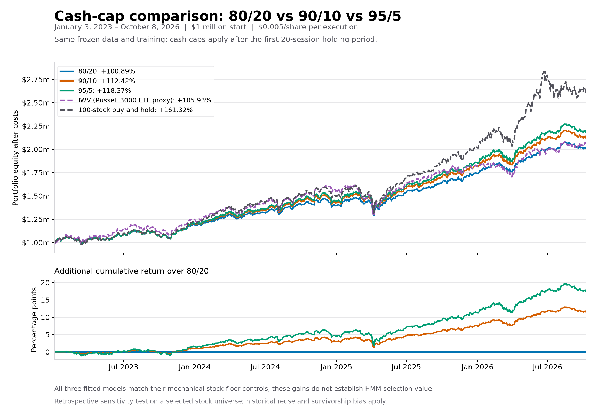
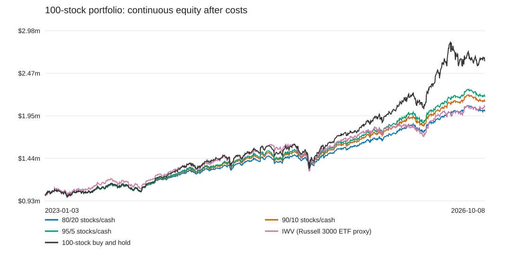

# Cash-cap comparison: 80/20, 90/10, and 95/5

Declared November 2, 2026. Same frozen 100-stock data, 2015–2022 training, seed 42, 20-session rebalance schedule, costs, and Treasury accounting as the existing 80/20 study. Only max_cash_weight changes; every cap/slippage version is independently fitted. Continuous evaluation: January 3, 2023 through October 8, 2026. All returns are cumulative after costs and modeled cash interest.

Each book starts with $1 million fully invested in the same equal-weight basket. The cash cap applies after the first scheduled rebalance, at daily opens; it is a maximum cash allocation, not an exact daily stock/cash ratio. Paid terminal liquidation is exempt.

The 95/5 run has the highest cumulative return among the three constrained versions; 80/20 has the smallest drawdown and highest Sharpe. Both 90/10 and 95/5 beat IWV in this historical window, while all three trail full-stock buy and hold. All six cap/slippage fits select the mechanical allocation fallback, so the comparison establishes allocation sensitivity rather than additional HMM trading value.

## Slippage: $0 per actual share per execution

| Allocation / benchmark | Final equity | Net return | Annualized return | Sharpe | Mean yearly Sharpe | SD yearly Sharpe | Max drawdown | Avg stock exposure | Return vs 80/20 | Execution costs |
|---|---:|---:|---:|---:|---:|---:|---:|---:|---:|---:|
| 80/20 | $2,009,292.84 | +100.93% | +20.38% | 1.349 | 1.400 | 0.162 | -12.99% | 80.69% | +0.00 pp | $0.00 |
| 90/10 | $2,124,646.95 | +112.46% | +22.18% | 1.339 | 1.390 | 0.174 | -14.58% | 90.36% | +11.54 pp | $0.00 |
| 95/5 | $2,184,133.57 | +118.41% | +23.08% | 1.335 | 1.386 | 0.179 | -15.36% | 95.18% | +17.48 pp | $0.00 |
| IWV (Russell 3000 ETF proxy) | $2,059,354.19 | +105.94% | +21.17% | 1.040 | 1.109 | 0.358 | -20.41% | 100.00% | +5.01 pp | $0.00 |
| 100-stock buy and hold | $2,613,423.62 | +161.34% | +29.09% | 1.323 | 1.347 | 0.076 | -18.46% | 100.00% | +60.41 pp | $0.00 |

## Slippage: $0.005 per actual share per execution

| Allocation / benchmark | Final equity | Net return | Annualized return | Sharpe | Mean yearly Sharpe | SD yearly Sharpe | Max drawdown | Avg stock exposure | Return vs 80/20 | Execution costs |
|---|---:|---:|---:|---:|---:|---:|---:|---:|---:|---:|
| 80/20 | $2,008,922.56 | +100.89% | +20.38% | 1.349 | 1.399 | 0.162 | -12.99% | 80.69% | +0.00 pp | $253.30 |
| 90/10 | $2,124,240.52 | +112.42% | +22.17% | 1.339 | 1.390 | 0.174 | -14.58% | 90.36% | +11.53 pp | $275.06 |
| 95/5 | $2,183,706.92 | +118.37% | +23.07% | 1.334 | 1.386 | 0.179 | -15.36% | 95.18% | +17.48 pp | $287.11 |
| IWV (Russell 3000 ETF proxy) | $2,059,284.30 | +105.93% | +21.17% | 1.040 | 1.109 | 0.358 | -20.41% | 100.00% | +5.04 pp | $46.02 |
| 100-stock buy and hold | $2,613,217.91 | +161.32% | +29.09% | 1.323 | 1.347 | 0.076 | -18.46% | 100.00% | +60.43 pp | $121.33 |

## Trained policy checks

- 80/20, zero_slippage: {"0": "cash", "1": "cash"}; daily equity matches its mechanical stock-floor control: True.
- 80/20, half_cent_slippage: {"0": "cash", "1": "cash"}; daily equity matches its mechanical stock-floor control: True.
- 90/10, zero_slippage: {"0": "cash", "1": "cash"}; daily equity matches its mechanical stock-floor control: True.
- 90/10, half_cent_slippage: {"0": "cash", "1": "cash"}; daily equity matches its mechanical stock-floor control: True.
- 95/5, zero_slippage: {"0": "cash", "1": "cash"}; daily equity matches its mechanical stock-floor control: True.
- 95/5, half_cent_slippage: {"0": "cash", "1": "cash"}; daily equity matches its mechanical stock-floor control: True.

Policy labels of cash refer to the mandatory equal-weight stock-floor fallback in these constrained experiments. When a run matches that control, increased returns reflect allocation exposure rather than demonstrated HMM selection value.

## Verification and reproduction

The portfolio acceptance suite passed 29 tests, including cap enforcement at 20%, 10%, and 5% after execution costs. All 288 saved metric rows reconcile their P&L attribution. Twelve continuous model/control daily books reconcile equity, meet their stock floors and cash caps, and match their chart data. Model sources and frozen-data manifest match across runs; benchmark metrics are unchanged. See verification.json for hashes and residuals.

Run the new studies with `.\.venv\Scripts\python.exe run_portfolio_study.py --plan portfolio_cash_limit_10_plan.json` and the corresponding `portfolio_cash_limit_5_plan.json`. Existing protocols are locked: a deliberate repeat requires a new `--output-dir`. Rebuild these tables and SVGs with `.\.venv\Scripts\python.exe results/cash_cap_comparison_20261102/build_comparison.py` after the studies complete.

Full daily books, policy locks, costs, standalone windows, and rolling 2022–2026 checks remain in each study's output folder. The original 80/20 run is preserved. PNG previews use the saved CSVs; SVGs need no plotting dependency. Rebuild the PNG preview with `python results/cash_cap_comparison_20261102/plot_preview.py` using a Python installation with pandas and matplotlib; no project dependencies were added.

Historical periods have already been examined. The selected stock universe has survivor and selection bias. These are retrospective sensitivity tests, not independent prospective evidence. IWV is an ETF proxy, not the official Russell 3000 index. Daily data cannot enforce an intraday cash cap.

## Yearly Sharpe summary

Mean yearly Sharpe and SD yearly Sharpe summarize 4 calendar-year observations per strategy, including partial 2026. SD is the sample standard deviation (ddof=1). These are separate from the full-period Sharpe. See [methodology and summary](SHARPE_STATISTICS.md), [yearly observations](yearly_sharpe.csv), and [summary CSV](sharpe_statistics.csv).
