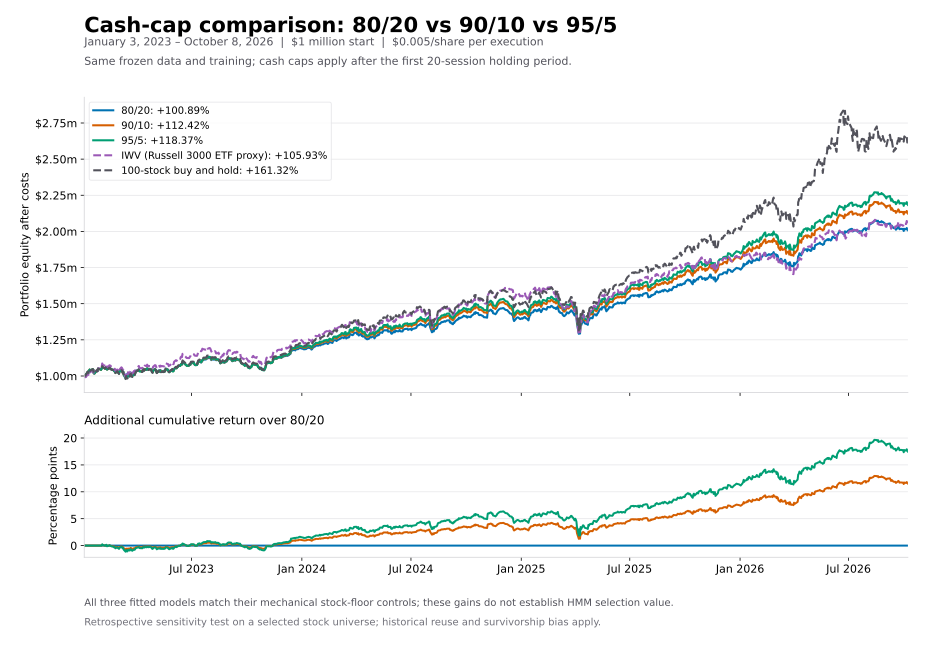

# Cash-cap comparison: 2023-01-03 through 2026-10-08

Training: 2015-01-01 through 2022. Each cash-cap/slippage version is fitted independently using the same frozen 100-stock data and seed 42. Continuous books retain holdings across year boundaries. All returns are cumulative, after execution costs and modeled cash interest.

Each book starts with $1 million equally invested. The cash cap applies at daily opens after the initial 20-session holding; terminal liquidation is exempt. Cash policy labels mean the mandatory equal-weight stock-floor fallback. A fitted momentum policy must show incremental value above that matched control.

## Slippage: $0 per actual share per execution

| Allocation / benchmark | Final equity | Net return | Annualized return | Full-period Sharpe | Mean yearly Sharpe | SD yearly Sharpe | Max drawdown | Avg exposure |
|---|---:|---:|---:|---:|---:|---:|---:|---:|
| 80/20 | $2,009,292.84 | +100.93% | +20.38% | 1.349 | 1.400 | 0.162 | -12.99% | 80.69% |
| 90/10 | $2,124,646.95 | +112.46% | +22.18% | 1.339 | 1.390 | 0.174 | -14.58% | 90.36% |
| 95/5 | $2,184,133.57 | +118.41% | +23.08% | 1.335 | 1.386 | 0.179 | -15.36% | 95.18% |
| IWV (Russell 3000 ETF proxy) | $2,059,354.19 | +105.94% | +21.17% | 1.040 | 1.109 | 0.358 | -20.41% | 100.00% |
| 100-stock buy and hold | $2,613,423.62 | +161.34% | +29.09% | 1.323 | 1.347 | 0.076 | -18.46% | 100.00% |

## Slippage: $0.005 per actual share per execution

| Allocation / benchmark | Final equity | Net return | Annualized return | Full-period Sharpe | Mean yearly Sharpe | SD yearly Sharpe | Max drawdown | Avg exposure |
|---|---:|---:|---:|---:|---:|---:|---:|---:|
| 80/20 | $2,008,922.56 | +100.89% | +20.38% | 1.349 | 1.399 | 0.162 | -12.99% | 80.69% |
| 90/10 | $2,124,240.52 | +112.42% | +22.17% | 1.339 | 1.390 | 0.174 | -14.58% | 90.36% |
| 95/5 | $2,183,706.92 | +118.37% | +23.07% | 1.334 | 1.386 | 0.179 | -15.36% | 95.18% |
| IWV (Russell 3000 ETF proxy) | $2,059,284.30 | +105.93% | +21.17% | 1.040 | 1.109 | 0.358 | -20.41% | 100.00% |
| 100-stock buy and hold | $2,613,217.91 | +161.32% | +29.09% | 1.323 | 1.347 | 0.076 | -18.46% | 100.00% |

## Trained policies

- 80/20, zero_slippage: {"0": "cash", "1": "cash"}; matches the mechanical stock-floor control: True.
- 80/20, half_cent_slippage: {"0": "cash", "1": "cash"}; matches the mechanical stock-floor control: True.
- 90/10, zero_slippage: {"0": "cash", "1": "cash"}; matches the mechanical stock-floor control: True.
- 90/10, half_cent_slippage: {"0": "cash", "1": "cash"}; matches the mechanical stock-floor control: True.
- 95/5, zero_slippage: {"0": "cash", "1": "cash"}; matches the mechanical stock-floor control: True.
- 95/5, half_cent_slippage: {"0": "cash", "1": "cash"}; matches the mechanical stock-floor control: True.

Matching the control means the HMM added no incremental value in that run. More compulsory stock exposure can increase both return and drawdown.

## Method and verification

[Methodology](../../docs/METHODOLOGY.md) · [Yearly Sharpe details](SHARPE_STATISTICS.md) · [Comparison CSV](comparison.csv) · [Yearly observations](yearly_sharpe.csv) · [Verification](verification.json)

The yearly Sharpe summaries use 4 calendar-year observations, including partial 2026. Standard deviation is the sample SD across yearly Sharpes (ddof=1), not a standard error or confidence interval.

Rebuild this report after running its three plans: `python compare_portfolios.py --window 2023`. Optional PNG preview: `python plot_comparison.py --window 2023` using a Python installation with matplotlib. Full study books and source/policy locks remain in ignored output/.

Current selected 100-stock list has survivor and selection bias. Historical evaluation periods were already observed. Adjusted-price total returns and reconstructed quoted prices depend on vendor corporate-action accuracy; they are research approximations. Neither independent fitting nor lower execution costs guarantees a different selected policy or profitable results.
