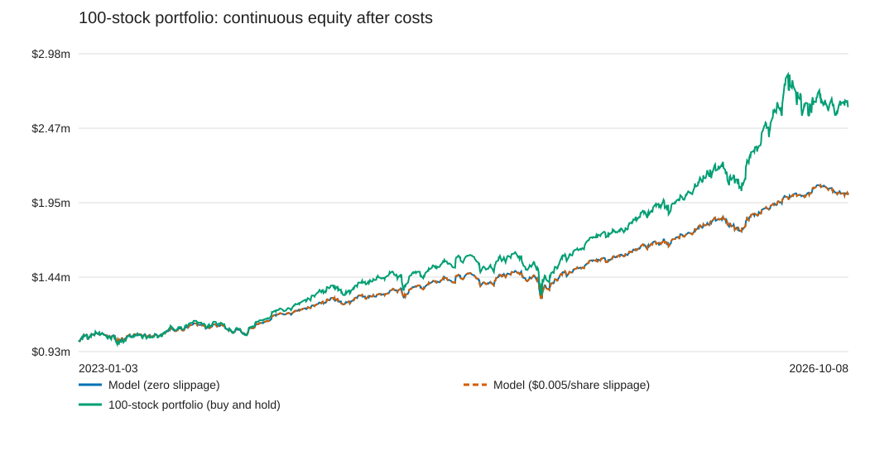
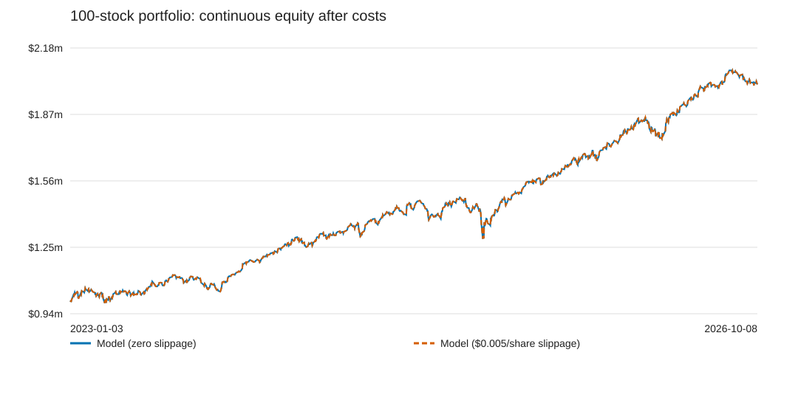

# 100-stock portfolio: 2015 training and per-share slippage

Each slippage version fits independently on the same inputs and seed. The primary model uses the existing 100-stock momentum-only HMM hypothesis.

Main training: 2015–2022. Warm-up prices begin June 2014. Evaluation history was previously observed and is research data.

Every independent book starts with $1,000,000. All stock strategies buy equal dollar amounts at the first open; costs come from that budget. Shares remain fixed until the first model rebalance 20 trading sessions later. Subsequent model decisions may hold cash. The continuous book carries positions across year boundaries; standalone windows and yearly checks restart separately.

Slippage is fixed at $0 or $0.005 per actual share, on each side, including liquidation. Commission remains zero. Adjusted-price total returns approximate dividend reinvestment without adding dividends again; quoted opens are reconstructed from Yahoo split history for share-based fees.

Sharpe uses [DGS10](https://fred.stlouisfed.org/series/DGS10), lagged two stock sessions and accrued at the prior-open yield using elapsed calendar days / 365. It is sqrt(252) times the mean interval excess return divided by its sample standard deviation. Entry costs belong to the first holding interval. Idle cash separately earns the existing [DGS3MO](https://fred.stlouisfed.org/series/DGS3MO) approximation. The 10-year yield is a reference yield, not a realized bond total return.

## Continuous portfolio: 2023 through October 8, 2026

| Slippage | Strategy | Final equity | Net return | Annualized return | Sharpe | Max drawdown | Execution costs | Avg exposure |
|---|---|---:|---:|---:|---:|---:|---:|---:|
| $0/share | hmm | $2,009,292.84 | +100.93% | +20.38% | 1.349 | -12.99% | $0.00 | 80.69% |
| $0/share | ungated_momentum | $1,993,787.32 | +99.38% | +20.13% | 1.315 | -11.79% | $0.00 | 80.74% |
| $0/share | passive_stocks | $2,613,423.62 | +161.34% | +29.09% | 1.323 | -18.46% | $0.00 | 100.00% |
| $0/share | iwv | $2,059,354.19 | +105.94% | +21.17% | 1.040 | -20.41% | $0.00 | 100.00% |
| $0/share | cash | $1,192,020.58 | +19.20% | +4.78% | 6.992 | +0.00% | $0.00 | 0.00% |
| $0/share | equal_weight_floor | $2,009,292.84 | +100.93% | +20.38% | 1.349 | -12.99% | $0.00 | 80.69% |
| $0.005/share | hmm | $2,008,922.56 | +100.89% | +20.38% | 1.349 | -12.99% | $253.30 | 80.69% |
| $0.005/share | ungated_momentum | $1,991,750.67 | +99.18% | +20.10% | 1.313 | -11.79% | $1,416.33 | 80.74% |
| $0.005/share | passive_stocks | $2,613,217.91 | +161.32% | +29.09% | 1.323 | -18.46% | $121.33 | 100.00% |
| $0.005/share | iwv | $2,059,284.30 | +105.93% | +21.17% | 1.040 | -20.41% | $46.02 | 100.00% |
| $0.005/share | cash | $1,192,020.58 | +19.20% | +4.78% | 6.992 | +0.00% | $0.00 | 0.00% |
| $0.005/share | equal_weight_floor | $2,008,922.56 | +100.89% | +20.38% | 1.349 | -12.99% | $253.30 | 80.69% |

## Independently trained policies

- zero_slippage: {"0": "cash", "1": "cash"}
- half_cent_slippage: {"0": "cash", "1": "cash"}

Cash is capped at 20% at each observed daily open, except terminal liquidation. After the initial 100% stock holding, target shortfalls are filled equally across all 100 stocks. Price declines or interest can trigger equal-dollar top-up purchases between scheduled rebalances; intraday breaches cannot be observed with daily data.

State policies labeled cash mean the equal-weight stock-floor fallback in this constrained study. A momentum policy must clear the conservative training bound on incremental daily returns above that fallback, with matching execution costs and zero calibration interest. Required stock exposure alone cannot qualify a model.

The equal_weight_floor control follows the same first-month holding, scheduled rebalances, daily floor enforcement, cash interest, and costs, with no HMM or stock-selection signal. Positive model-minus-control returns may also reflect different stock exposure within the allowed 80–100% range; they do not isolate stock-selection skill.

The separate training runs selected the same state policy. This is a valid result; no different policy was forced.

The initial basket is imposed, so its 100 completed positions cannot be interpreted as 100 model-selected entries. Training eligibility excludes that imposed purchase. See imposed_initial_holding_market_pnl and average_model_exposure_after_initial_holding in the machine tables.

## Standalone windows and expanding-training checks

| Period | Slippage | Strategy | Net return | Sharpe | Max drawdown |
|---|---|---|---:|---:|---:|
| standalone_2023_2025 | $0/share | hmm | +74.19% | 1.300 | -12.99% |
| standalone_2023_2025 | $0/share | passive_stocks | +101.84% | 1.305 | -18.46% |
| standalone_2026 | $0/share | hmm | +16.50% | 1.720 | -5.42% |
| standalone_2026 | $0/share | passive_stocks | +19.33% | 1.503 | -6.99% |
| rolling_2022 | $0/share | hmm | -5.89% | -0.410 | -17.79% |
| rolling_2022 | $0/share | passive_stocks | -6.78% | -0.366 | -20.33% |
| rolling_2023 | $0/share | hmm | +19.39% | 1.340 | -6.85% |
| rolling_2023 | $0/share | passive_stocks | +22.66% | 1.317 | -8.83% |
| rolling_2024 | $0/share | hmm | +17.37% | 1.337 | -6.16% |
| rolling_2024 | $0/share | passive_stocks | +20.00% | 1.272 | -7.54% |
| rolling_2025 | $0/share | hmm | +25.48% | 1.345 | -13.01% |
| rolling_2025 | $0/share | passive_stocks | +31.45% | 1.386 | -15.93% |
| rolling_2026 | $0/share | hmm | +16.50% | 1.720 | -5.42% |
| rolling_2026 | $0/share | passive_stocks | +19.33% | 1.503 | -6.99% |
| standalone_2023_2025 | $0.005/share | hmm | +74.16% | 1.299 | -12.99% |
| standalone_2023_2025 | $0.005/share | passive_stocks | +101.82% | 1.305 | -18.46% |
| standalone_2026 | $0.005/share | hmm | +16.49% | 1.719 | -5.42% |
| standalone_2026 | $0.005/share | passive_stocks | +19.32% | 1.503 | -6.99% |
| rolling_2022 | $0.005/share | hmm | -5.91% | -0.410 | -17.80% |
| rolling_2022 | $0.005/share | passive_stocks | -6.78% | -0.367 | -20.33% |
| rolling_2023 | $0.005/share | hmm | +19.38% | 1.339 | -6.85% |
| rolling_2023 | $0.005/share | passive_stocks | +22.65% | 1.316 | -8.83% |
| rolling_2024 | $0.005/share | hmm | +17.35% | 1.336 | -6.16% |
| rolling_2024 | $0.005/share | passive_stocks | +19.99% | 1.271 | -7.54% |
| rolling_2025 | $0.005/share | hmm | +25.47% | 1.344 | -13.01% |
| rolling_2025 | $0.005/share | passive_stocks | +31.44% | 1.385 | -15.93% |
| rolling_2026 | $0.005/share | hmm | +16.49% | 1.719 | -5.42% |
| rolling_2026 | $0.005/share | passive_stocks | +19.32% | 1.503 | -6.99% |

Rolling year Y trains from 2015 through Y−2, leaves Y−1 as a validation gap, and evaluates Y. No configuration is selected using those evaluations. These independently restarted books are not compounded into the primary continuous result.

## Files and limitations

metrics.csv contains every strategy and window. Each version has policy locks, training diagnostics, regime probabilities, target weights, daily books, actual-share order costs, completed-position attribution, and per-stock passive returns. Original studies and the prospective paper registration are unchanged.

Current selected 100-stock list has survivor and selection bias. Historical evaluation periods were already observed. Adjusted-price total returns and reconstructed quoted prices depend on vendor corporate-action accuracy; they are research approximations. Neither independent fitting nor lower execution costs guarantees a different selected policy or profitable results.

IWV is an investable Russell 3000 ETF proxy, not the official index. The zero-slippage passive_stocks row represents the same 100-stock basket's adjusted open-to-open performance over the matching dates. Neither ETF fund fees nor dividends are deducted/added a second time.
