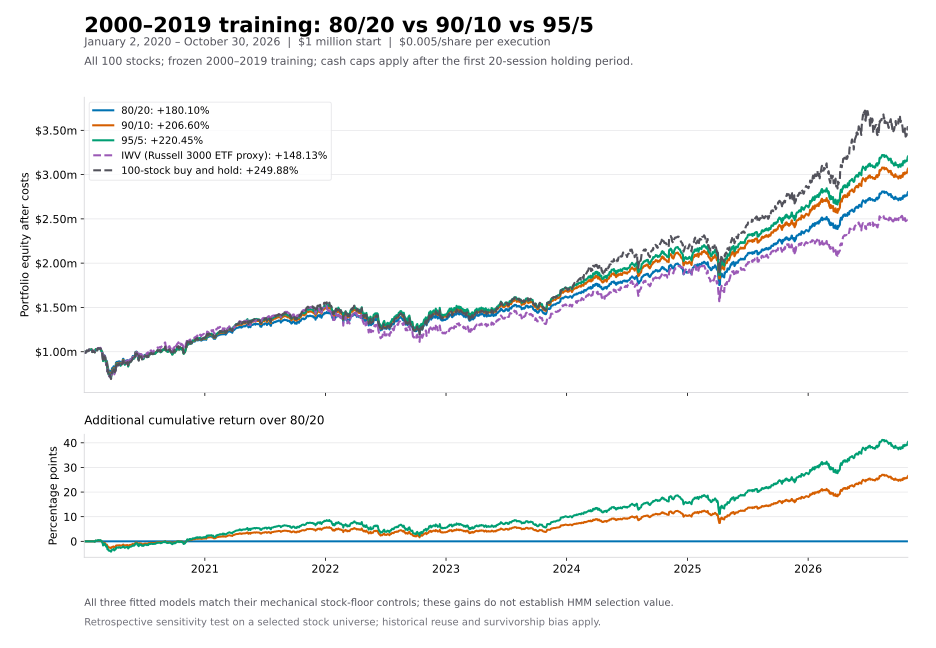

# Cash-cap comparison: 2020-01-02 through 2026-10-30

Training: 2000-01-01 through 2019. Each cash-cap/slippage version is fitted independently using the same frozen 100-stock data and seed 42. Continuous books retain holdings across year boundaries. All returns are cumulative, after execution costs and modeled cash interest.

Each book starts with $1 million equally invested. The cash cap applies at daily opens after the initial 20-session holding; terminal liquidation is exempt. Cash policy labels mean the mandatory equal-weight stock-floor fallback. A fitted momentum policy must show incremental value above that matched control.

## Slippage: $0 per actual share per execution

| Allocation / benchmark | Final equity | Net return | Annualized return | Full-period Sharpe | Mean yearly Sharpe | SD yearly Sharpe | Max drawdown | Avg exposure |
|---|---:|---:|---:|---:|---:|---:|---:|---:|
| 80/20 | $2,801,823.47 | +180.18% | +16.29% | 0.875 | 1.183 | 0.853 | -28.00% | 80.57% |
| 90/10 | $3,066,916.99 | +206.69% | +17.84% | 0.877 | 1.184 | 0.855 | -30.96% | 90.30% |
| 95/5 | $3,205,508.77 | +220.55% | +18.61% | 0.877 | 1.184 | 0.856 | -32.41% | 95.16% |
| IWV (Russell 3000 ETF proxy) | $2,481,381.30 | +148.14% | +14.24% | 0.620 | 0.830 | 0.877 | -33.46% | 100.00% |
| 100-stock buy and hold | $3,499,114.80 | +249.91% | +20.14% | 0.863 | 1.073 | 0.835 | -33.45% | 100.00% |

## Slippage: $0.005 per actual share per execution

| Allocation / benchmark | Final equity | Net return | Annualized return | Full-period Sharpe | Mean yearly Sharpe | SD yearly Sharpe | Max drawdown | Avg exposure |
|---|---:|---:|---:|---:|---:|---:|---:|---:|
| 80/20 | $2,800,973.48 | +180.10% | +16.29% | 0.874 | 1.183 | 0.853 | -28.00% | 80.57% |
| 90/10 | $3,065,952.22 | +206.60% | +17.84% | 0.876 | 1.184 | 0.855 | -30.96% | 90.30% |
| 95/5 | $3,204,481.55 | +220.45% | +18.60% | 0.877 | 1.184 | 0.856 | -32.41% | 95.16% |
| IWV (Russell 3000 ETF proxy) | $2,481,287.10 | +148.13% | +14.24% | 0.619 | 0.830 | 0.877 | -33.46% | 100.00% |
| 100-stock buy and hold | $3,498,816.95 | +249.88% | +20.14% | 0.863 | 1.073 | 0.835 | -33.45% | 100.00% |

## Trained policies

- 80/20, zero_slippage: {"0": "cash", "1": "cash"}; matches the mechanical stock-floor control: True.
- 80/20, half_cent_slippage: {"0": "cash", "1": "cash"}; matches the mechanical stock-floor control: True.
- 90/10, zero_slippage: {"0": "cash", "1": "cash"}; matches the mechanical stock-floor control: True.
- 90/10, half_cent_slippage: {"0": "cash", "1": "cash"}; matches the mechanical stock-floor control: True.
- 95/5, zero_slippage: {"0": "cash", "1": "cash"}; matches the mechanical stock-floor control: True.
- 95/5, half_cent_slippage: {"0": "cash", "1": "cash"}; matches the mechanical stock-floor control: True.

Matching the control means the HMM added no incremental value in that run. More compulsory stock exposure can increase both return and drawdown.

## Method and verification

[Methodology](../../docs/METHODOLOGY.md) · [Yearly Sharpe details](SHARPE_STATISTICS.md) · [Comparison CSV](comparison.csv) · [Yearly observations](yearly_sharpe.csv) · [Verification](verification.json)

The yearly Sharpe summaries use 7 calendar-year observations, including partial 2026. Standard deviation is the sample SD across yearly Sharpes (ddof=1), not a standard error or confidence interval.

Rebuild this report after running its three plans: `python compare_portfolios.py --window 2020`. Optional PNG preview: `python plot_comparison.py --window 2020` using a Python installation with matplotlib. Full study books and source/policy locks remain in ignored output/.

Current selected 100-stock list has survivor and selection bias. Historical evaluation periods were already observed. Adjusted-price total returns and reconstructed quoted prices depend on vendor corporate-action accuracy; they are research approximations. Neither independent fitting nor lower execution costs guarantees a different selected policy or profitable results.
