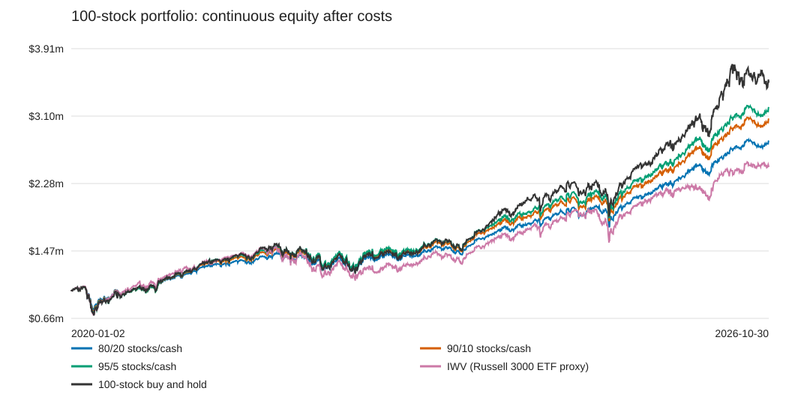

# Training from 2000: 80/20, 90/10, and 95/5

Declared November 2, 2026. New frozen 100-stock data, 2000–2019 training, seed 42, 20-session rebalance schedule, costs, and Treasury accounting across all three new cash-cap studies. Only max_cash_weight changes; every cap/slippage version is independently fitted. Continuous evaluation: January 2, 2020 through October 30, 2026. All returns are cumulative after costs and modeled cash interest.

Each book starts with $1 million fully invested in the same equal-weight basket. The cash cap applies after the first scheduled rebalance, at daily opens; it is a maximum cash allocation, not an exact daily stock/cash ratio. Paid terminal liquidation is exempt.

All six cap/slippage fits select the mechanical allocation fallback, so this comparison measures allocation sensitivity rather than additional HMM trading value. Each policy is frozen after training; there are no yearly refits in this study.

## Slippage: $0 per actual share per execution

| Allocation / benchmark | Final equity | Net return | Annualized return | Sharpe | Mean yearly Sharpe | SD yearly Sharpe | Max drawdown | Avg stock exposure | Return vs 80/20 | Execution costs |
|---|---:|---:|---:|---:|---:|---:|---:|---:|---:|---:|
| 80/20 | $2,801,823.47 | +180.18% | +16.29% | 0.875 | 1.183 | 0.853 | -28.00% | 80.57% | +0.00 pp | $0.00 |
| 90/10 | $3,066,916.99 | +206.69% | +17.84% | 0.877 | 1.184 | 0.855 | -30.96% | 90.30% | +26.51 pp | $0.00 |
| 95/5 | $3,205,508.77 | +220.55% | +18.61% | 0.877 | 1.184 | 0.856 | -32.41% | 95.16% | +40.37 pp | $0.00 |
| IWV (Russell 3000 ETF proxy) | $2,481,381.30 | +148.14% | +14.24% | 0.620 | 0.830 | 0.877 | -33.46% | 100.00% | -32.04 pp | $0.00 |
| 100-stock buy and hold | $3,499,114.80 | +249.91% | +20.14% | 0.863 | 1.073 | 0.835 | -33.45% | 100.00% | +69.73 pp | $0.00 |

## Slippage: $0.005 per actual share per execution

| Allocation / benchmark | Final equity | Net return | Annualized return | Sharpe | Mean yearly Sharpe | SD yearly Sharpe | Max drawdown | Avg stock exposure | Return vs 80/20 | Execution costs |
|---|---:|---:|---:|---:|---:|---:|---:|---:|---:|---:|
| 80/20 | $2,800,973.48 | +180.10% | +16.29% | 0.874 | 1.183 | 0.853 | -28.00% | 80.57% | +0.00 pp | $457.83 |
| 90/10 | $3,065,952.22 | +206.60% | +17.84% | 0.876 | 1.184 | 0.855 | -30.96% | 90.30% | +26.50 pp | $506.68 |
| 95/5 | $3,204,481.55 | +220.45% | +18.60% | 0.877 | 1.184 | 0.856 | -32.41% | 95.16% | +40.35 pp | $533.05 |
| IWV (Russell 3000 ETF proxy) | $2,481,287.10 | +148.13% | +14.24% | 0.619 | 0.830 | 0.877 | -33.46% | 100.00% | -31.97 pp | $55.11 |
| 100-stock buy and hold | $3,498,816.95 | +249.88% | +20.14% | 0.863 | 1.073 | 0.835 | -33.45% | 100.00% | +69.78 pp | $150.05 |

## Trained policy checks

- 80/20, zero_slippage: {"0": "cash", "1": "cash"}; daily equity matches its mechanical stock-floor control: True.
- 80/20, half_cent_slippage: {"0": "cash", "1": "cash"}; daily equity matches its mechanical stock-floor control: True.
- 90/10, zero_slippage: {"0": "cash", "1": "cash"}; daily equity matches its mechanical stock-floor control: True.
- 90/10, half_cent_slippage: {"0": "cash", "1": "cash"}; daily equity matches its mechanical stock-floor control: True.
- 95/5, zero_slippage: {"0": "cash", "1": "cash"}; daily equity matches its mechanical stock-floor control: True.
- 95/5, half_cent_slippage: {"0": "cash", "1": "cash"}; daily equity matches its mechanical stock-floor control: True.

Policy labels of cash refer to the mandatory equal-weight stock-floor fallback in these constrained experiments. When a run matches that control, increased returns reflect allocation exposure rather than demonstrated HMM selection value.

## Verification and reproduction

The portfolio acceptance suite passed 33 portfolio tests; the full suite passed 104 tests, including cap enforcement at 20%, 10%, and 5% after execution costs. All 108 saved metric rows reconcile their P&L attribution. Twelve continuous model/control daily books reconcile equity, meet their stock floors and cash caps, and match their chart data. Model sources and frozen-data manifest match across runs; benchmark metrics are unchanged. See verification.json for hashes and residuals.

Run the new studies with `.\.venv\Scripts\python.exe run_portfolio_study.py --plan portfolio_train2000_cash10_plan.json` and the corresponding `portfolio_train2000_cash5_plan.json`. Existing protocols are locked: a deliberate repeat requires a new `--output-dir`. Rebuild these tables and SVGs with `.\.venv\Scripts\python.exe results/train2000_comparison_20261102/build_comparison.py` after the studies complete.

Full daily books, policy locks, costs, and standalone windows (2020–2025 and 2026) remain in each study's output folder. The previous 2023-start studies are preserved. PNG previews use the saved CSVs; SVGs need no plotting dependency. Rebuild the PNG preview with `python results/train2000_comparison_20261102/plot_preview.py` using a Python installation with pandas and matplotlib; no project dependencies were added.

All 100 stocks have 6,812 matching sessions from October 1, 1999 through October 30, 2026. Training includes 5,031 sessions from January 3, 2000 through December 31, 2019; continuous testing includes 1,717 sessions. Warm-up begins October 1999; the 100-session trend rule first becomes available February 24, 2000, and missing early signals remain inactive. IWV vendor history starts May 26, 2000, and covers every test session; it is not required for HMM training. The [issuer lists its launch date as May 22, 2000](https://www.blackrock.com/us/individual/products/239714/ishares-russell-3000-etf). No stocks or test sessions were dropped and no missing history was synthesized.

Historical periods have already been examined. The selected stock universe has survivor and selection bias. These are retrospective sensitivity tests, not independent prospective evidence. IWV is an ETF proxy, not the official Russell 3000 index. Daily data cannot enforce an intraday cash cap.

## Yearly Sharpe summary

Mean yearly Sharpe and SD yearly Sharpe summarize 7 calendar-year observations per strategy, including partial 2026. SD is the sample standard deviation (ddof=1). These are separate from the full-period Sharpe. See [methodology and summary](SHARPE_STATISTICS.md), [yearly observations](yearly_sharpe.csv), and [summary CSV](sharpe_statistics.csv).
